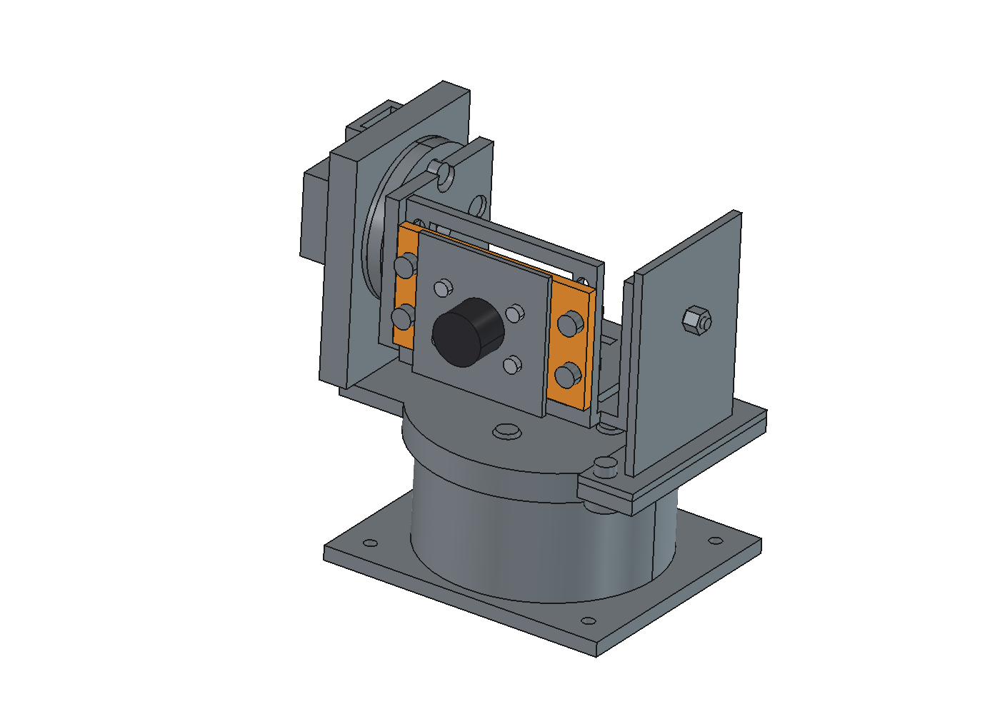
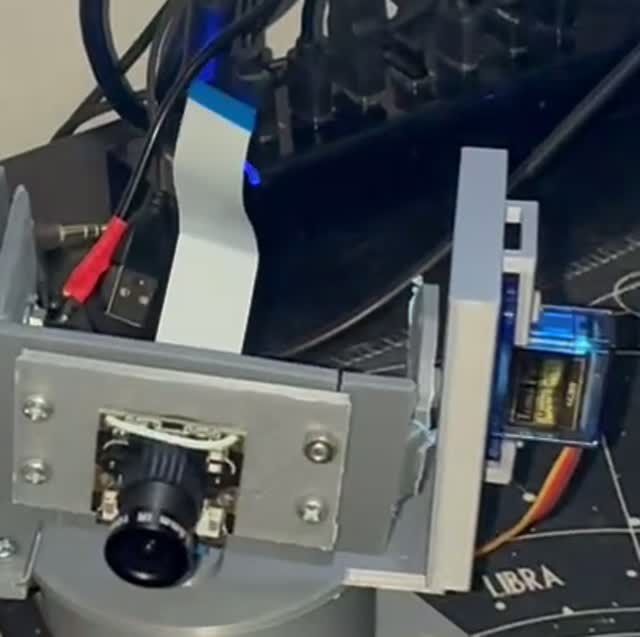
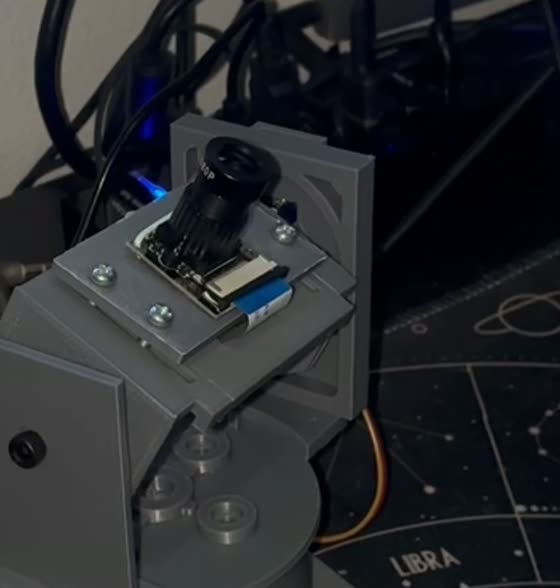
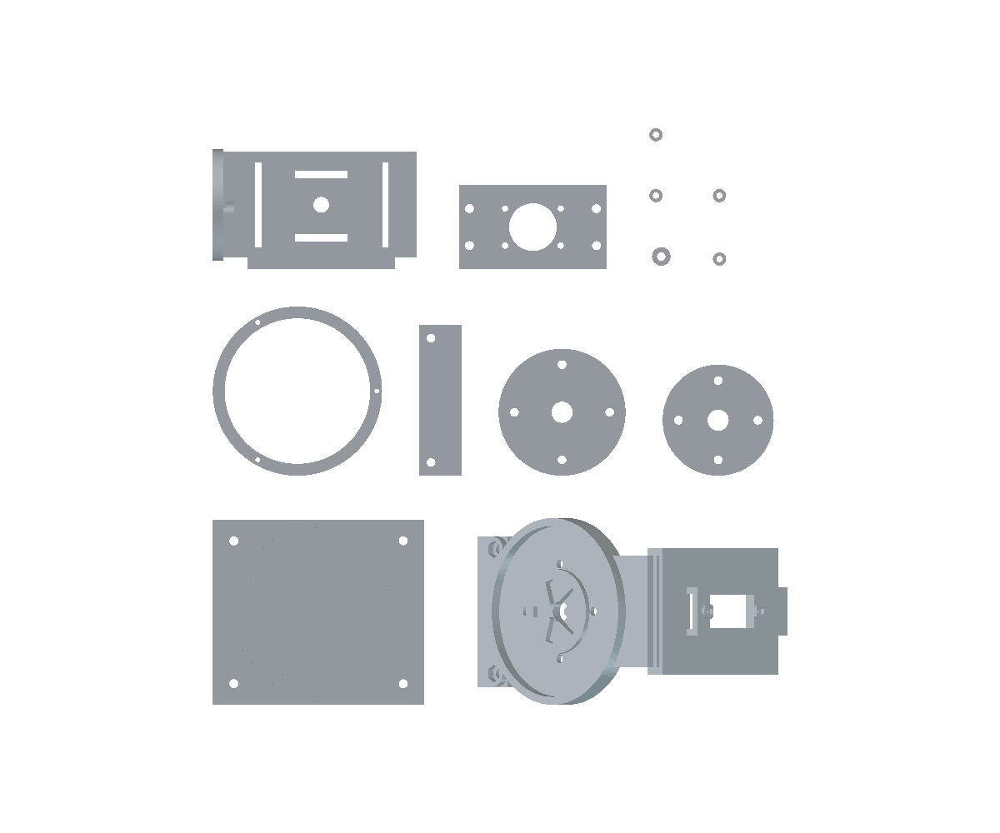
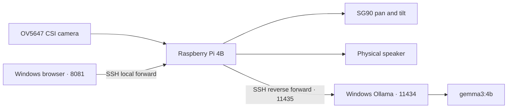
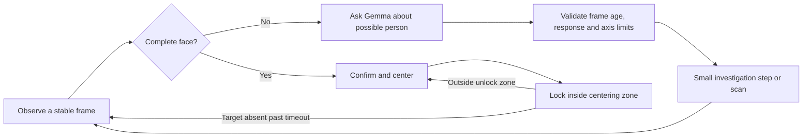
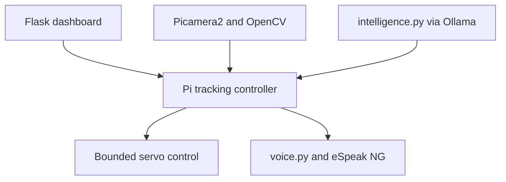

# Eye Trace — Intelligent Human Tracing Home Assistant

Eye Trace is a 3D-printed pan-and-tilt camera prototype. A Raspberry Pi operates the camera, servo controller, web dashboard and speaker. A Windows laptop runs Gemma 3 4B in Ollama to investigate possible people beyond the local face detector’s view. The archive records the working prototype as described by its builder and preserves the recovered mechanical designs and manufacturing evidence. The running Pi source is pending recovery.

## Download 3D Printing Files

**[Download the manufacturing ZIP](hardware/printing/EyeTrace_Manufacturing_Package.zip?raw=1)** · [SHA-256 checksum](hardware/printing/EyeTrace_Manufacturing_Package.zip.sha256)

- **Legacy five-arm, 21 × 14 mm camera pattern.** [All 13 individual STLs and print settings](PRINTING_FILES.md#individual-stl-downloads) · [Single-bed STL](hardware/3d-models/STL/EyeTrace_Final_K2_SingleBed_21x14.stl) · [Creality K2 ABS 3MF](hardware/3d-models/3MF/EyeTrace_K2_ABS_Full_21x14.3mf) · [Editable FreeCAD assembly](hardware/3d-models/FreeCAD/EyeTrace_Final_Assembly_21x14.FCStd) · [Editable print layout](hardware/3d-models/FreeCAD/K2_PrintLayout_21x14.FCStd)
- **R15 four-arm, engineering hold.** The white-horn pocket master and the R15 assembly are separate configurations from the complete legacy build. [R15 files and evidence](PRINTING_FILES.md#r15-four-arm-revision-on-engineering-hold) · [Camera, pan-ring, tilt-journal and horn fit tests](PRINTING_FILES.md#fit-tests-and-white-sg90-horn-gauges)

The production horn mold remains missing. The camera rear envelope and fasteners, printed joint clearances, and installed four-arm horn engagement still require physical verification. Both assembly versions remain on engineering hold. [Raspberry Pi runtime recovery](docs/recovery.md) is pending.

## Demonstration

The 31.5-second live recording shows the physical prototype changing pan and tilt positions and briefly shows the Raspberry Pi and bench wiring. The linked preview uses the original video stream with the audio removed for privacy. The untouched MP4 is preserved locally. See the [media record](media/demonstration/README.md).

## Key features

- Physical two-axis camera mount with editable FreeCAD assemblies and ABS manufacturing files.
- Historically working manual web controls, camera stream, local face tracking and offline speech.
- Local-network multimodal vision research with a Windows-hosted model and loopback SSH forwards.
- Separate fit-test artifacts for the camera plate, pan ring, tilt journal and servo horn.

## Project gallery

| Built prototype | Corrected CAD assembly | 13-part K2 bed |
| --- | --- | --- |
|  |  |  |

[Camera plate](media/CAD-renders/camera-mount-21x14.png) · [Camera coupon](media/CAD-renders/camera-coupon.png) · [Cross-horn Prototype 03](media/CAD-renders/cross-horn-prototype-03.png) · [Tilt position](media/project-images/tilt-position.jpg) · [Bench wiring](media/project-images/bench-wiring.jpg)

## Experimental results

| Evidence | Result |
| --- | --- |
| Historical text inference | 160 tokens, 12.7745659 s total, approximately 26.31 tokens/s during generation |
| Historical vision test | Gemma described a low-light image and reported a person in the lower-right quadrant |
| Reopened camera coupon | 21 × 14 mm hole centers measured from native geometry |
| Reopened full-bed STL | 13 closed components, 217.097 × 218.000 × 67.175 mm |
| Corrected ABS full-bed slice | 124.33 g and 11 h 45 m 59 s estimated |

[AI vision](results/AI-vision-results.md) · [Performance](results/performance-results.md) · [Tracking](results/tracking-results.md) · [Mechanical results](results/mechanical-results.md) · [Validation summary](results/test-summary.md)

## System architecture

## Mechanical design

The selected 21 × 14 mm correction changes camera **mounting-hole pitch**. The 21 × 16 mm predecessor and later test revisions are preserved as engineering history. The [FreeCAD assembly](hardware/3d-models/FreeCAD/EyeTrace_Final_Assembly_21x14.FCStd), [native motion assembly](hardware/3d-models/assembly/EyeTrace_Final_Assembly_Native_21x14.FCStd), and [STEP assembly](hardware/3d-models/STEP/EyeTrace_Final_Assembly_21x14.step) represent the documented correction. The physical demo does not identify a unique CAD revision. See [mechanical design](docs/mechanical.md).

## Electronics and wiring

Builder-reported wiring uses BCM18 / physical pin 12 for pan, BCM13 / physical pin 33 for tilt, and physical pin 6 for the shared ground. The camera connects by CSI. The installed servo power topology and speaker interface need physical verification. See the [wiring diagram and BOM](hardware/electronics/wiring-and-bom.md).

## AI intelligence architecture

Picamera2 captures frames and OpenCV handles fast local detection. Gemma receives selected images over the tunnel and returns structured observations for higher-level direction. GPIO remains under the Pi controller. See [AI and voice](docs/ai-tracking-voice.md).

## Intelligent tracking workflow

This diagram describes the intended V5 workflow. Current integration requires source readback from the Pi.

## Software architecture

The reported endpoint set and startup guardrails are in [Raspberry Pi setup](docs/raspberry-pi.md). The local repository includes new setup and diagnostic scripts. The original controller, AI and voice files remain on the unreachable Pi.

## Raspberry Pi installation

Use a Pi 4B running Debian 13 Trixie with Raspberry Pi camera packages and system Python. Run the dependency installer and camera enumeration before connecting servo power. Recover and review the original source before starting a clean installation. [Pi commands and service management](docs/raspberry-pi.md).

## Windows Ollama installation

Start Ollama locally, download gemma3:4b, set your SSH target and establish both loopback forwards. [PowerShell commands and verification](docs/windows-ollama.md).

## 3D printing and assembly

Load the [camera coupon 3MF](hardware/3d-models/fit-tests/Camera_21x14_ABS_FitTest.3mf) first. Check physical fit, horn engagement and cable clearance before approving the [corrected K2 full-bed project](hardware/3d-models/3MF/EyeTrace_K2_ABS_Full_21x14.3mf). [Printing and assembly sequence](hardware/printing/manufacturing.md).

## Calibration

With power removed, check travel and ribbon slack. Record intended neutral angles, small test steps and verified mechanical bounds. Use the [offline calibration planner](software/raspberry-pi/calibration-plan.py), then measure the physical response in manual mode with the original controller. [Calibration procedure](docs/raspberry-pi.md#calibration-and-first-run).

## Usage

Start the Windows tunnel and open the dashboard at http://localhost:8081. Begin in manual or idle after the initial safety checks. Explicitly enable tracking when the sweep area is clear. Use stop/release to return to a stationary state, and isolate servo power if movement becomes unsafe.

## Troubleshooting

[Camera, GPIO, tunnel and audio troubleshooting](docs/raspberry-pi.md#troubleshooting) · [SSH and Ollama failures](docs/windows-ollama.md#troubleshooting).

## Development history

[Mechanical revisions, bring-up, tracking, AI migration and demonstration](docs/development-history.md).

## Known limitations

- Current runtime implementation, Pi package versions, GPIO polarity, measured motion limits and dashboard routes await readback.
- Camera fastener/rear-component clearance remains open in the corrected CAD evidence. The native model still carries an old camera plate label in one document.
- Historical inference is a single observation. Identity recognition and browser microphone conversation are unverified.
- Bench footage establishes observable motion. Autonomous control mode, tracking accuracy and performance cannot be derived from the footage.
- Treat the Flask interface as unauthenticated. Keep both services on loopback, use SSH with a verified host key, and keep camera media private.

## Future improvements

Close the mechanical fit and cable-clearance checks, benchmark tracking and recovery from target loss, verify local safety interlocks, and evaluate offline neural speech and microphone input.

## Repository structure

| Path | Contents |
| --- | --- |
| [hardware](hardware) | Promoted native CAD, STEP, print beds, coupons, wiring and manufacturing |
| [software](software) | Pi and Windows setup and diagnostics |
| [config](config) | Portable example settings |
| [media](media) | Prototype frames, CAD gallery and media provenance |
| [results](results) | Historical experimental records and fresh validation |
| [docs](docs) | System documentation and development history |
| [archive](archive) | Original revision trees and recovery manifest |
| [tests](tests) | Hardware-free project checks |

[Security and publication review](docs/security-review.md).
