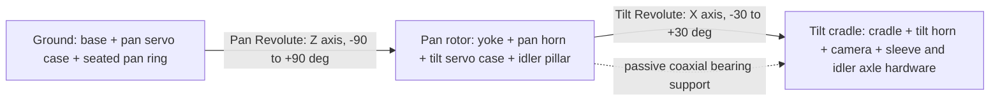

# Eye Trace motion audit 02

## Verdict

| Item | Verdict | Evidence and limit |
|---|---|---|
| PAN DRIVE | UNVERIFIED | The CAD chain is present and the modeled star arm contacts the yoke pocket wall after about 1.5 degrees of relative clearance. Actual star horn, spline, screw, and clone fit are provisional. |
| TILT DRIVE | UNVERIFIED | The CAD chain is present and its modeled horn arm has the same positive wall stop. The actual horn/spline engagement and screw retention have not been fitted. |
| TWO DEGREES OF FREEDOM | PASS (CAD mechanism) | The new FreeCAD Assembly document contains one grounded rigid body, two revolute joints, three connected rigid bodies, solver return 0, and two independent DOF. The source assembly itself had no joints. |
| HORN TORQUE CONNECTION | UNVERIFIED | The design uses a keyed horn arm captured by a printed pocket/cover, rather than friction alone. Modeled wall contact is positive, but the real horn shape, backlash, attachment screw, and torque capacity are not confirmed. |
| PHYSICAL MOTION | UNVERIFIED | No physical assembly or unpowered hand sweep was performed. |

This is a kinematic CAD audit, not release approval. It does not approve the full ABS print. Existing ABS files and release status were left unchanged.

## Audited files

- Source: `../CAD/EyeTrace_Final_Assembly.FCStd` (80 objects; no joint objects), SHA-256 `e6ab2cc261ee79528a6cedf12601531d7531141a5e4a3147d9b41d37fa382124`.
- Audit assembly: `EyeTrace_Motion_Audit_Assembly_r03.FCStd`, generated/opened/solved with installed FreeCAD 1.1.4.
- Repeatable check: `CHECKS/validate_motion_audit.py`; machine-readable result: `CHECKS/motion_validation.json`.
- Actual CAD views and rendered animation are in `RENDERS/`.

The source assembly is a static CAD document. r03 is a separate kinematic audit document made from the source components; it does not overwrite the source or any print deliverable.

## Mechanical chain

1. Base body is grounded. Pan servo case and its ears are rigid with the base.
2. Pan Revolute joint rotates the pan rotor relative to the base about Z through `(0, 0, 35) mm`.
3. Pan horn is attached to the pan servo output reference; its modeled star arm enters the keyed pocket on the pan yoke. The yoke, tilt servo case, and tilt support pillar rotate together with the pan rotor.
4. Tilt Revolute joint rotates the camera cradle relative to the pan rotor about X through `(-41, 0, 78) mm`.
5. Tilt horn arm enters the keyed pocket on the cradle; cradle, camera plate, and camera envelopes move together.
6. The opposite-side pillar is fixed to the pan rotor. Its sleeve, idler screw, nut, and washer are grouped with the cradle as a rotating axle stack. The pillar provides passive support; it is not a second solver joint. A second explicit revolute at that end would duplicate the same axis and overconstrain this three-body solver model.

### Joint connectivity

The dashed support is physical bearing geometry represented within the same two rigid bodies. It does not add an independent rotation variable.

### Torque paths

- **Pan:** fixed pan servo case → output/shaft reference → original star horn (provisional) → keyed arm/pocket wall and cover → pan yoke/rotor.
- **Tilt:** tilt servo case fixed to pan rotor → output/shaft reference → original star horn (provisional) → keyed arm/pocket wall and cover → camera cradle.

At the neutral position the modeled arm-to-pocket gaps are 0.25 mm (pan) and 0.20 mm (tilt), with no overlap. The modeled horn arm reaches its positive pocket wall after approximately 1.5 degrees relative rotation; the CAD intersection at that stop is 0.7706 mm³ per interface. That is evidence of a modeled geometric torque stop, not proof that an actual molded horn fits or can withstand load. The servo output boss is an envelope in the reference model; spline teeth are not invented or validated.

## Motion and clearance results

- Solver: return code 0; max joint-center alignment error `2.94e-14 mm`.
- Pan-only: 91 positions, -90 to +90 degrees at 2-degree steps; no modeled interpenetrations against grounded base/stator.
- Tilt-only: 61 positions, -30 to +30 degrees at 1-degree steps; no modeled interpenetrations against pan rotor/stator.
- Passive opposite pivot: 61 positions over the same tilt range; no modeled sleeve/axle-to-pillar penetration.
- Simultaneous: 91 grid positions over pan -90..+90 at 15-degree increments and tilt -30..+30 at 10-degree increments; no modeled interpenetrations against base.
- Camera board envelope to pan yoke: at +30 degrees gap is 2.813 mm; at +41 degrees gap is 0.157 mm; a small modeled intersection begins by +42 degrees. Hence r03 uses ±30-degree tilt soft limits for margin.
- Opposite pivot fit distances: cradle-to-pillar 0.5 mm, sleeve-to-pillar 0.1 mm, cradle-to-fastener 0.5 mm, sleeve-to-idler hardware 0 mm distance with no volume overlap. The zero-distance axial contact means nut/washer preload could pinch the rotating stack; CAD cannot establish free physical rotation.

These sweeps check the available detailed solids and envelope keepouts. They cannot check cable flex where only a static/keepout representation exists, nor dimensions omitted from the camera/servo clone models. The sampled ranges are software test ranges, not guaranteed physical travel ranges.

## Actual command angles

The screenshots and animation use joint coordinates, where `0°` is CAD neutral. The audit limits are pan ±90° and tilt ±30°. They are not calibrated servo pulse widths or guaranteed SG90 travel. No PWM pulse mapping is available, and no physical hard stops are modeled. Cable routing and strain may reduce usable pan travel. Until hardware is assembled and checked, do not command to the model limits; begin with a small, unloaded bench range (about ±10°) and stop if any binding, wire tension, horn slip, or contact occurs. Calibrate pulse-to-angle on the actual servos; never force a servo against a mechanical stop.

## Views and animation

- Neutral assembly: `RENDERS/assembled_neutral_isometric.png`
- Pan endpoints: `RENDERS/pan_m090_deg.png`, `RENDERS/pan_p000_deg.png`, `RENDERS/pan_p090_deg.png`
- Tilt endpoints: `RENDERS/tilt_m030_deg.png`, `RENDERS/tilt_p000_deg.png`, `RENDERS/tilt_p030_deg.png`
- Combined endpoints: `RENDERS/simultaneous_pan_m90_tilt_m30.png`, `RENDERS/simultaneous_pan_p90_tilt_p30.png`
- Drive closeups: `RENDERS/pan_servo_horn_closeup.png`, `RENDERS/tilt_servo_horn_closeup.png`
- Actual FreeCAD viewport animation (51 frames, pan-only, tilt-only, and combined motion): `RENDERS/EyeTrace_Motion_Independent_and_Simultaneous.gif`
- Frame angle data: `CHECKS/animation_frames.json`; solved transforms: `CHECKS/transform_states.json`.

## Remaining physical verification

1. Fit each actual SG90 into its bracket; verify ears sit flat, screw holes align, and the case can be installed/removed without trapping its lead.
2. With each original horn off the servo, compare its molded center spline and arm profile against the provisional model. Confirm the original retaining screw seats and engages without bottoming. Do not drill or force the spline.
3. Assemble each horn pocket/cover and rotate the structure gently by hand through the small initial range. Confirm the arm is positively captured, backlash is acceptable, cover does not pinch, and no horn slips.
4. Hand-assemble the opposite pivot. Tighten the specified hardware only enough to retain it; verify the cradle rotates freely with no axial pinch, then check for wobble.
5. Install the actual camera on the 21 × 16 mm center-to-center plate. Confirm hole diameter, PCB outline, lens and rear component envelope, screw head clearance, ribbon connector access, and cable bend radius.
6. Route the actual ribbon and servo leads. With servos unpowered, sweep pan and tilt separately and together; check for snagging, twisting, tension, and collision throughout the intended range.
7. Only after these checks, energize at low speed/limited command range and verify actual pulse-to-angle behavior and both torque paths under the camera's mass.

Any failure requires a measured photo with a ruler/caliper in the same plane, plus the failed printed coupon or interface measurements. Physical fit and strength remain unverified until these steps pass.
