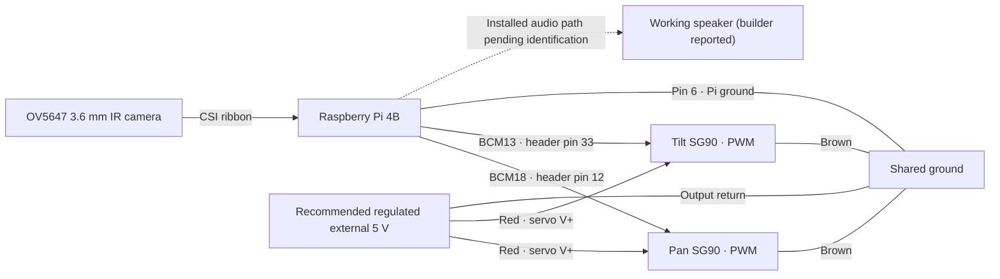

# Electronics and wiring

The pin assignments below come from the builder’s working setup. Check the installed harness before energizing a rebuild.

| Pi header pin | Signal | Harness connection |
| --- | --- | --- |
| 12 | BCM18 | Pan control wire, orange or yellow by convention |
| 33 | BCM13 | Tilt control wire, orange or yellow by convention |
| 6 | GND | Common Pi and servo supply reference |
| CSI connector | Camera data and power | OV5647 module ribbon |

Check wire labels and hardware orientation. Power down before touching the CSI ribbon. A missing shared ground caused unstable servo behavior during development. The common ground makes PWM voltage meaningful at both devices. Size a regulated external 5 V servo supply for simultaneous startup and peak load after verifying the installed servos, with an accessible power cutoff. Do not feed servo supply current through GPIO pins or tie two independent positive rails together. Power the Pi through its supported supply path. Keep the axis travel clear, and begin with servo power isolated while validating software. A physical power switch is the emergency stop if loss of control prevents a graceful release.

## Bill of materials

| Quantity | Item | Evidence / disposition |
| ---: | --- | --- |
| 1 | Raspberry Pi 4 Model B and supported supply | Builder-reported controller |
| 1 | OV5647-compatible 3.6 mm IR camera and GPIO-free CSI ribbon connection | Builder-reported camera family |
| 2 | TowerPro SG90 9 g servos, cross horns and retaining screws | Builder specification and CAD references |
| 1 set | ABS printed pan-and-tilt parts | Original CAD and recovered 3MF files |
| 4 sets | M3 × 10 screws and nuts | Corrected CAD BOM for structural joints |
| 4 sets | Camera fasteners and spacers | CAD models provisional M2 × 12, physical fit pending |
| 1 | Physical speaker/audio path | Builder-reported operation, electrical interface pending |
| 1 | Windows laptop | Ollama AI host |
| 1 | External regulated 5 V supply, fused as appropriate and sized by measured load | Recommended |
| 1 | Reachable servo supply cutoff | Recommended |

The experimental power source and whether the installed speaker uses analog, USB, HDMI or an amplifier require bench inspection. A passive speaker requires a properly specified audio driver. Do not connect it directly to GPIO.
